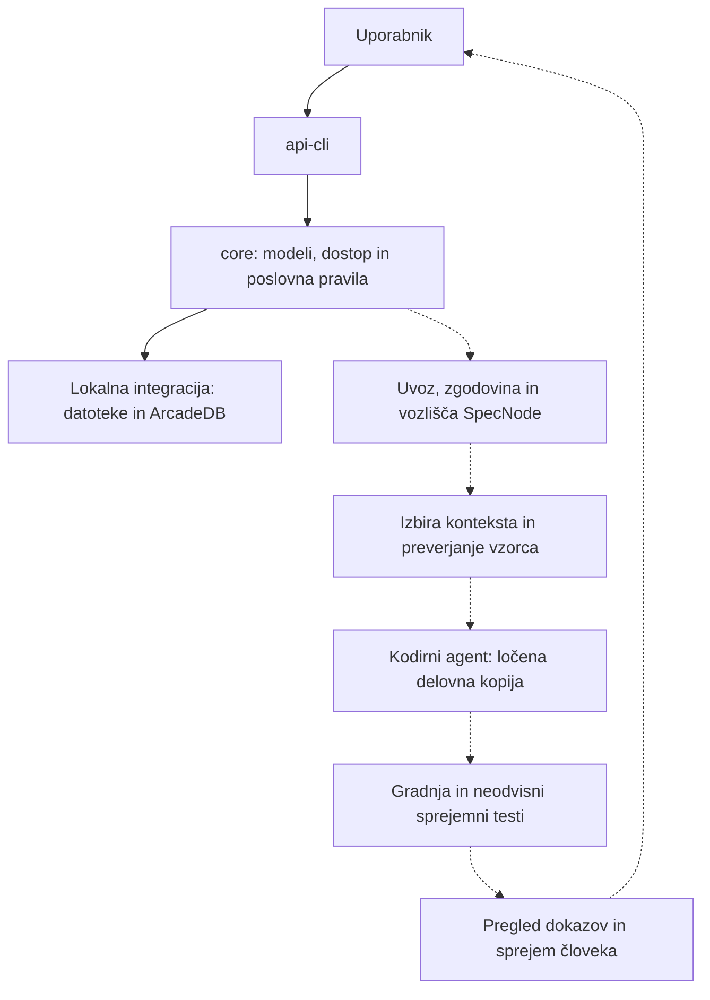

# Bistra: priprava specifikacij in konteksta za agentni razvoj kode

## 1. Osnovni podatki

Številka skupine: 6

Člana: Peter Šavron, Tim Tisak

Izbran tip projekta: B (agentni razvoj kode)

Poročilo nadgrajuje [prijavo teme](<Predstavitev projekta.md>). Projekt obravnava pripravo sledljivega konteksta iz specifikacij in njegov vpliv na agentno implementacijo. Skladno s povratno informacijo določamo primerjalni postopek in merila uspeha pred izvedbo eksperimentov.

## 2. Problem in predlagana rešitev

**AS-IS:** razvijalec ročno prebere specifikacije, izbere gradivo za nalogo in usmerja kodirnega agenta. Razpršene zahteve, ponavljajoča se pravila in odvisnosti med razdelki otežujejo izbiro konteksta. Izpuščene zahteve in nejasnosti pogosto odkrijemo šele pri implementaciji; po spremembi dokumenta je treba ponovno preveriti kontekst. Obsega teh težav še nismo izmerili.

**TO-BE:** uporabnik določi lokalni vir, Bistra pa uvozi dokumente, ohrani njihove različice in izvor ter jih razdeli v povezana vozlišča `SpecNode`. Za nalogo izbere ustrezne razdelke, skupna pravila in arhitekturni vzorec. Nejasnosti preda človeku, potrjeni kontekst pa kodirnemu agentu. Rezultat preverijo neodvisni sprejemni testi in človek.

Prvi načrtovani korak je deterministična razdelitev Markdowna na razdelke s hierarhijo in izvornimi vrsticami. Pomenske povezave, skupne definicije in preslikava v arhitekturne gradnike bodo sledile pozneje. Uvoz in razčlenjevanje še nista del oddajne različice. Preverili bomo, ali pripravljeni kontekst zmanjša porabo žetonov ob primerljivi pravilnosti implementacije; sama razdelitev dokumentov tega še ne dokazuje.

## 3. Cilji in obseg

| Cilj | Dokaz doseganja |
| --- | --- |
| C1: registracija lokalnega vira | Uspešna registracija; preverjena neobstoječa mapa in nedovoljen dostop. |
| C2: sledljiv uvoz Markdowna in besedila | Znani izvorna pot, različica in normalizirano besedilo. |
| C3: hierarhija vozlišč razdelkov | Ujemanje z ročno označenimi razdelki, povezavami in vrsticami. |
| C4: ponovljiv in varen uvoz | Brez podvajanja; napaka branja ohrani zadnjo uspešno objavo. |
| C5: kontekst za razvojno nalogo | Izvoz zahtevanih vozlišč, skupnih pravil in sklicev na izvor. |
| C6: evalvacija agentne implementacije | Primerjava pravilnosti, žetonov, časa in posegov človeka. |

C1–C4 so prvi funkcionalni korak, C5–C6 nadaljevanje. Na demonstracijskem primeru bomo preverili tudi en preprost arhitekturni vzorec in njegove obvezne povezave. Splošno sklepanje o arhitekturi poljubnega sistema presega obseg.

Za prvo različico uvoza načrtujemo podporo lokalnim UTF-8 datotekam Markdown in navadnemu besedilu, s predvideno omejitvijo 16 MiB na dokument. PDF/DOCX, MCP, napredno pomensko iskanje, spletni vmesnik in oblačna namestitev so poznejše razširitve. Načrtovana avtomatizacija zajema pripravo konteksta in implementacijo omejene naloge; poslovne prioritete, potrditev sprememb zahtev, sprejem kode in produkcijska namestitev bodo ostali človeku.

Trenutni CLI shranjuje podatke v ArcadeDB in datotečni sistem; zgodovino kode in dokumentacije vodimo z Gitom. Zgodovina uvoženih specifikacij v Gitu je načrtovana. Demonstracijska specifikacija je testna vsebina; pri evalvaciji bodo klici LLM resnični. Morebitne simulacije bomo uporabljali za preverjanje integracij, zasebno dokumentacijo pa le z dovoljenjem.

## 4. Tehnična zasnova

V oddajni veji `release/vmesna-oddaja` modul `api-cli` obravnava ukaze za uporabnike, skrivnosti, delovne prostore in seje. `core` vsebuje njihove modele, preverjanje dostopa in poslovna pravila. `integration-local-storage` izvaja shranjevanje v datoteke in ArcadeDB. Sinhronizacija specifikacij, razčlenjevanje, zgodovina in agentni koraki so nadaljnje delo. Polne povezave prikazujejo obstoječe module, črtkane pa načrtovano delovanje:

Načrtovani model ločuje `SpecSource` za vir in izbor datotek, `Spec` za stanje dokumenta, `RawSpec` za objavljeno besedilo ter `SpecNode` za razdelek s hierarhijo in izvorom. Vozlišča bodo ohranila sklice na različico dokumenta in izvorne vrstice. Napaka pri uvozu bo morala ohraniti prejšnjo uspešno objavo; delni pregled mape ne bo smel pomeniti izbrisa neopaženih datotek. Izhodišče je [predlog SpecSource](../docs/todo/SpecSource.md), povezovanje vsebine pa opisujeta zasnovi [Feature](../docs/features/Feature.md) in [Pattern](../docs/features/Pattern.md). Ta postopek v oddajni veji še ni implementiran.

| Tehnologije | Namen in stanje |
| --- | --- |
| Java 21, Maven, Quarkus/CDI | Obstoječe večmodulno okolje; sestavljanje storitev z injiciranjem vmesnikov. |
| Picocli, JLine | Ukazi in interaktivni vnosi lokalnega CLI. |
| ArcadeDB, datotečni sistem | Implementirana lokalna hramba uporabnikov, delovnih prostorov, sej in šifriranih skrivnosti. Graf arhitekture je načrtovan. |
| Git, JGit | Git uporabljamo za kodo in dokumentacijo. JGit za zgodovino uvoženih specifikacij še ni vključen v oddajno vejo. |
| Apache Tika Core | Predvideno zaznavanje tipov dokumentov; odvisnost in integracija še nista vključeni v oddajno vejo. |
| LangChain4j | Načrtovana povezava z LLM in agentnimi koraki. |
| JUnit, Mockito | Obstoječi testi uporabniške logike in izolacija odvisnosti. |

V načrtovanem postopku bo agent za pripravo specifikacije predlagal povezave in vprašanja, kodirni agent pa bo urejal dovoljene datoteke ter zaganjal gradnjo in teste. Vloge bomo lahko izvajali zaporedno. Orodja bodo omejena na delovni prostor, specifikacije, Git in dovoljene ukaze. Agenti ne bodo dobili gesel ali razkritih vrednosti skrivnosti; uvoženo besedilo ne bo spreminjalo dovoljenj. Agent ne bo smel spreminjati sprejemnih testov ali potrjevati novih zahtev.

Posamezna evalvacijska izvedba ima največ 15 minut in dva kroga popravkov po začetnem predlogu. Nejasnosti se vrnejo človeku; napaka orodja, prekoračitev omejitve ali ponavljajoč neuspeh testov zaključijo izvedbo z zabeleženim neuspehom.

## 5. Primer razvojne naloge

Uporabimo [Personal Task List](../examples/task-list/SPEC.md), ločeno brskalniško aplikacijo za evalvacijo. Bistra ostaja Java CLI. Primer **TASK 01 – dodajanje opravila** zahteva:

| Vnos ali dejanje | Sprejemni kriterij |
| --- | --- |
| Add ali Enter z veljavnim naslovom | Natanko eno novo opravilo; vnos se izprazni. |
| `  Buy milk  ` | Naslov se shrani kot `Buy milk`. |
| Prazen vnos, sami presledki ali 121 znakov | Validacijsko sporočilo; seznam se ne spremeni. Naslov s 120 znaki je sprejet. |
| Dvakrat isti naslov | Dve opravili z različnima stabilnima `id`. |
| Besedilo HTML | Prikaz kot besedilo, brez izvajanja kode. |

Novo opravilo ima `completed=false` in čas `createdAt`. Predlagana izvedba uporablja HTML/CSS in module JavaScript: `TaskForm` obravnava vnos, `TaskService` validacijo in model, `TaskList` prikaz, `TaskRepository` shrambo. Tehnične izbire (`crypto.randomUUID()`, ISO 8601, `textContent`) označimo ločeno od izvornih zahtev. Obe poti oddaje uporabljata isto operacijo; seznam ohrani vrstni red ustvarjanja. Vedenje ob nedostopnem `localStorage` ostaja odprto vprašanje za človeka.

Pred implementacijo človek potrdi zahteve in pripravi neodvisne sprejemne teste, predvidoma s Playwrightom. Bistra izbere zahtevo, model in povezana pravila; agent izdela model in storitev, nato poveže vmesnik. Odda razliko kode, kontekst in rezultate testov. Človek sprejme spremembo po uspešnih obveznih testih in pregledu pokritosti zahtev ter obsega sprememb. Demonstracijska aplikacija še ni implementirana.

## 6. Načrt evalvacije

### Priprava specifikacij

Pred zagonom ročno označimo pričakovana vozlišča, povezave in vrstice v testnem korpusu. Preverimo hierarhijo, ponovljene in Unicode naslove, ATX/Setext zapis, kodne bloke ter prazne dokumente in dokumente brez naslovov. Ponovni uvoz mora obravnavati spremembe, preimenovanja, izbrise in vrnitve datotek brez podvajanja.

Negativni scenariji vključujejo neveljaven UTF-8, prevelike ali neberljive datoteke, spremembo med branjem, delni pregled mape, nedovoljen dostop, sočasno sinhronizacijo in prekinitev pred objavo. Preverimo jasno napako, ohranitev prejšnje objave in odsotnost delno objavljenih podatkov.

### Primerjava agentnega razvoja

Primerjamo isti model in nalogo z **izvorno specifikacijo (AS-IS)** ter s **kontekstom Bistre (TO-BE)**. Uporabimo šest nalog: dodajanje, prikaz, spreminjanje dokončanosti, brisanje, filtriranje in ohranjanje po ponovnem nalaganju. Tri ponovitve v obeh pogojih pomenijo **36 izvedb**.

Vsaka naloga ima svoj začetni commit z enakimi predpogoji v obeh pogojih. Izvedbe uporabljajo sveže delovne kopije in pogovore, izmeničen vrstni red pogojev ter enake nastavitve modela, orodja, omejitve in sprejemne teste. Izbiro konteksta zamrznemo pred meritvami. Pojasnila zahtev in tehnična pravila so dostopna obema pogojema; razlikujeta se izbira in predstavitev konteksta. Izvorno gradivo hranimo ločeno od kode, da TO-BE ne dobi celotne specifikacije po drugi poti.

| Metrika | Merjenje in cilj |
| --- | --- |
| Pravilnost uvoza in sledljivost | Vsi pričakovani razdelki in povezave pravilni; 100 % vozlišč z veljavnim dokumentom, različico in vrsticami na testnem korpusu. |
| Uspešnost implementacije | Delež izvedb z vsemi uspešnimi obveznimi testi in delež uspešnih posameznih testov; TO-BE vsaj na ravni AS-IS. |
| Poraba žetonov | Vsi vhodni, izhodni in dodatno obračunani žetoni, vključno s popravki; cilj vsaj 20 % manj na nalogo ob enaki ali boljši uspešnosti. |
| Čas | Priprava konteksta, klici modela in testi; mediane ter razponi. |
| Posegi človeka | Vsebinska pojasnila in usmeritve; končni pregled ločeno. Ročni popravek kode pomeni neuspeh agenta. |

Vključimo neuspešne izvedbe in strošek priprave konteksta, tudi morebitne klice LLM. Pripravo prikažemo posebej, enakomerno porazdeljeno med šest nalog ter za uporabo pri eni nalogi. Začetno človeško pripravo merimo ločeno. Manj žetonov ob slabši pravilnosti ne pomeni doseženega cilja. Zaradi majhnega vzorca rezultate prikažemo po nalogah, z medianami in razponi, brez posploševanja na vse modele in projekte.

Za vsako izvedbo shranimo različice kode in dokumentov, model in nastavitve, poziv, kontekst s sklici, razliko kode, rezultate testov, porabo, čas in posege človeka; povzetek zberemo v CSV/JSON brez poverilnic. Človek preverja izvorne zahteve. Zahteva brez dokaza ostane odprta; popravek napačnega testa velja za oba pogoja in zahteva ponovitev prizadetih izvedb. Primerjalnih rezultatov še ni.

## 7. Trenutno stanje in naslednji koraki

Stanje na dan 28. 11. 2026 se nanaša na oddajno vejo `release/vmesna-oddaja`. Razvojni začetki podpore specifikacijam v veji `main` niso del te različice.

| Del | Stanje |
| --- | --- |
| Večmodulna aplikacija, osnovni CLI in shramba | Implementirani; [uporabniki](../docs/api/cli/User.md), [delovni prostori](../docs/api/cli/Workspace.md) in [seje](../docs/api/cli/Session.md) so opisani v dokumentaciji, gradnja v [README](../README.md). CLI za seje še ne podpira izbire delovnega prostora z `--workspace` ali ukaza `session stop --global`. |
| Registracija virov, uvoz in `SpecNode` | Načrtovano. Oddajna veja še ne vsebuje uvoza, razčlenjevalnika, vozlišč `SpecNode` ali zgodovine specifikacij. C1–C4 še niso doseženi. |
| Demonstracijska specifikacija | Pripravljena; ciljna aplikacija še ni izdelana. |
| Izbira konteksta, agenti in evalvacija | Načrtovano; C5–C6 še nista dosežena. |
| Podporna orodja | Pripravljen [skript za ArcadeDB Studio](../scripts/arcadedb-studio.sh) za pregled lokalne baze. Preverjena sta sintaksa Bash in prikaz pomoči; zagon ArcadeDB v vsebniku Docker še ni potrjen. |
| [UserSecret](../docs/features/Secret.md) | Implementirani ukazi za ustvarjanje, seznam, razkritje, posodobitev in brisanje. Skrivnost pripada enemu uporabniku; vrednost je šifrirana z AES-256-GCM, njen podatkovni ključ pa s ključem, izpeljanim iz gesla lastnika. Razkritje zahteva ponovno preverjanje gesla. Deljenje in lastništvo delovnega prostora nista podprta. |

Zadnja čista gradnja oddajne veje, `mvn -o -B -ntp -pl api-cli -am clean package` (28. 11. 2026), je uspela: **5 testov, brez neuspehov, napak ali preskokov**. Testi preverjajo uporabniško logiko, gesla, prijavo/odjavo in lokalni uporabniški repozitorij. Preizkus zapakiranega CLI z začasno shrambo je uspešno opravil še **30 preverjanj**, vključno z uporabniki, delovnimi prostori, sejami, uporabo privzetih nastavitev seje ter CRUD nad skrivnostmi. Pri skrivnostih smo preverili tudi obstojnost med zagoni, ločitev uporabnikov, zavrnitev napačnega gesla, binarne vrednosti in dostop po odjavi/prijavi. Preverjanja CLI so bila izvedena z začasnim skriptom; namenski regresijski testi UserSecret še niso vključeni v Maven testni paket. Uvoz specifikacij in agentna evalvacija še nista bila izvedena.

Naslednji koraki so implementacija lokalnega uvoza in razčlenjevanja z namenskimi testi C1–C4, nato izvoz konteksta z enim arhitekturnim vzorcem ter priprava začetnih različic nalog in zamrznjenih sprejemnih testov za primerjavo. Pri UserSecret ostajata namensko testiranje in povezava menjave gesla s ponovnim šifriranjem podatkovnih ključev; menjava gesla še ni implementirana.
